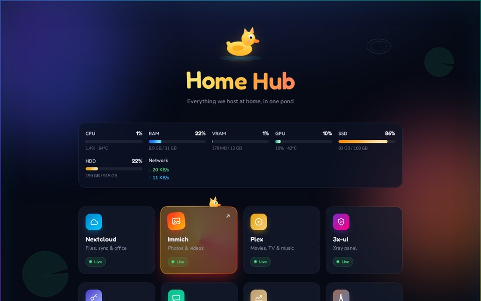
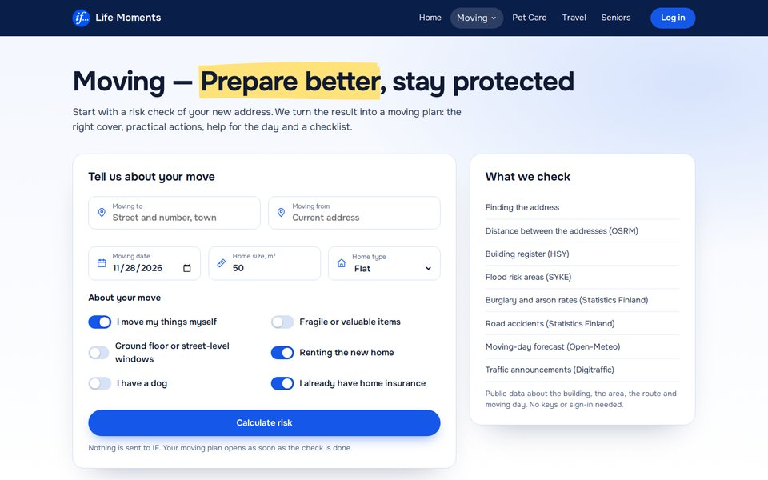
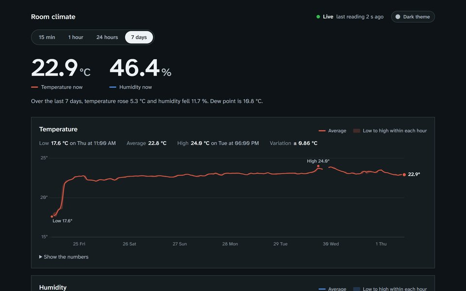
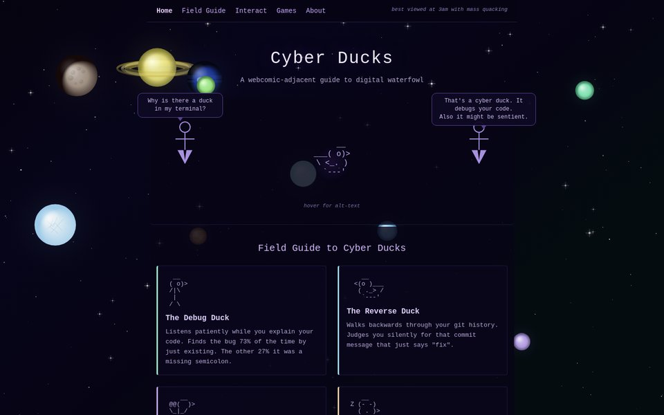

ICT student at **Turku University of Applied Sciences** in Finland. I like projects that leave the laptop and run for real people: a self-hosted server that hosts files, photos and chat for my friends, a hackathon app built on Finnish open data, and small hardware that reports from another apartment.

## Projects

<table>
<tr>
<td width="50%" valign="top">

### [MeowHub](https://github.com/Qumetri/MeowHub)
My home server as one Docker Compose stack: Nextcloud, Immich, a Matrix messenger with calls, a media downloader, a crypto tracker with Telegram alerts and a Telegram bot with a Mini App that gives friends access to all of it.

   

</td>
<td width="50%" valign="top">

### [If Life Moments](https://github.com/Qumetri/JunctionX2026Project)
Junction 2026 hackathon, If Insurance challenge. Enter the address you are moving to and the app checks the building, flood areas, crime rates and moving-day weather against Finnish open data, then turns the risks into a moving plan.

   

</td>
</tr>
<tr>
<td width="50%" valign="top">

### [ESP32 Sensor Dashboard](https://github.com/Qumetri/esp32-sensor-dashboard)
An ESP32 with a DHT-22 sends temperature and humidity every minute. An Express server validates and stores the readings and draws charts that keep gaps visible and don't exaggerate sensor noise.

   

</td>
<td width="50%" valign="top">

### [Cyber Ducks](https://github.com/Qumetri/QuackProject)
A webcomic-style field guide to ducks that debug your code. It has a terminal you can type commands into and a few small browser games.

  

</td>
</tr>
</table>

Earlier work: five Unity games in C# ([Tower Defence](https://github.com/Qumetri/TowerDefence), [Rocket Mouse](https://github.com/Qumetri/RocketMouse), [Cannon Game](https://github.com/Qumetri/CannonGame), [Little Bird 2D](https://github.com/Qumetri/LittleBird2D), [Roll a Ball](https://github.com/Qumetri/RollAndBall)), a [Raspberry Pi Pico temperature tracker](https://github.com/Qumetri/InHouseTempTracker) with an OLED screen, and a [Paint clone](https://github.com/Qumetri/Paint) in Visual Basic.

## Toolbox

<table>
<tr><td><b>Languages</b></td><td></td></tr>
<tr><td><b>Web</b></td><td></td></tr>
<tr><td><b>Servers</b></td><td></td></tr>
<tr><td><b>Hardware & games</b></td><td></td></tr>
</table>

## How I got here

1. **2019.** First desktop app: a Paint clone in Visual Basic .NET.
2. **Unity courses.** Five small games in C#, then learning object-oriented programming properly.
3. **freeCodeCamp.** HTML and CSS pages and a first look at accessibility.
4. **Turku UAS.** Git, JavaScript and a Raspberry Pi Pico that shows the room temperature on an OLED.
5. **2026.** An ESP32 sensor dashboard, a home server for friends and family, and the Junction hackathon.

## Activity

<picture>
  <source media="(prefers-color-scheme: dark)" srcset="https://streak-stats.demolab.com?user=Qumetri&theme=dark&background=0D111700&hide_border=true&ring=F59E0B&fire=F59E0B&currStreakLabel=F59E0B" />
  
</picture>

<picture>
  <source media="(prefers-color-scheme: dark)" srcset="https://raw.githubusercontent.com/Qumetri/Qumetri/output/duck-snake-dark.svg" />
  
</picture>

